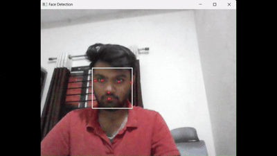

# OpenCV Projects

**A collection of hands-on computer vision projects built with Python, OpenCV, and MediaPipe.**

Welcome to my computer vision portfolio! This repository showcases practical projects exploring real-time visual detection using a webcam.

## Projects

### 1. Hand Detection

A real-time hand detection application that detects up to two hands and displays their landmarks and connections.


**Technologies:** Python, OpenCV, MediaPipe

- [View Source Code](hand-detection/hand_detection.py)
- [Project Documentation](hand-detection/)

### 2. Face Detection

A real-time face detection application that detects faces from a webcam feed and displays visual annotations.



**Technologies:** Python, OpenCV, MediaPipe

- [View Source Code](face-detection/face_detection.py)
- [Project Documentation](face-detection/)

## Technologies

- Python
- OpenCV
- MediaPipe
- Git and GitHub

## About

I'm an engineering student interested in robotics, computer vision, and intelligent systems. I enjoy learning by building practical projects and improving my programming skills.

More projects and improvements will be added as I continue learning.

## Repository Structure

```text
opencv-projects/
├── hand-detection/
│   ├── assets/
│   ├── hand_detection.py
│   ├── requirements.txt
│   └── README.md
├── face-detection/
│   ├── assets/
│   ├── face_detection.py
│   ├── requirements.txt
│   └── README.md
└── README.md
```

---

Thanks for visiting! ⭐

## ✋ Screen Brightness Control Using Hand Gestures

Control screen brightness using hand gestures with Python, OpenCV, and MediaPipe.

- [View Project](screen-brightness-control/)
- [View Demo Video](screen-brightness-control/assets/demo.mp4)
